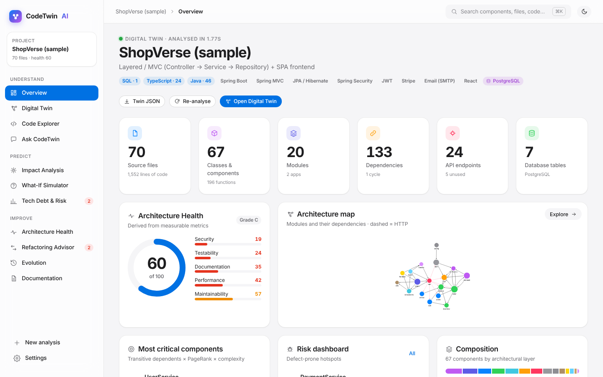
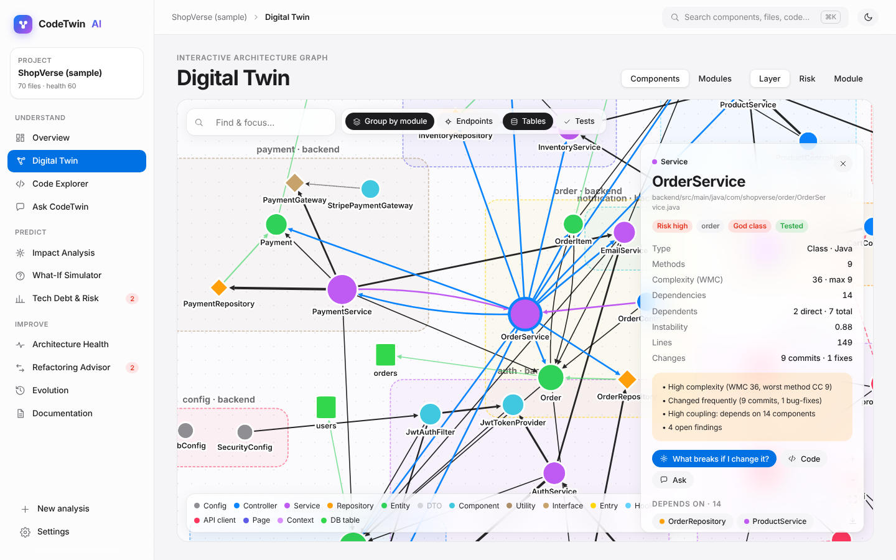
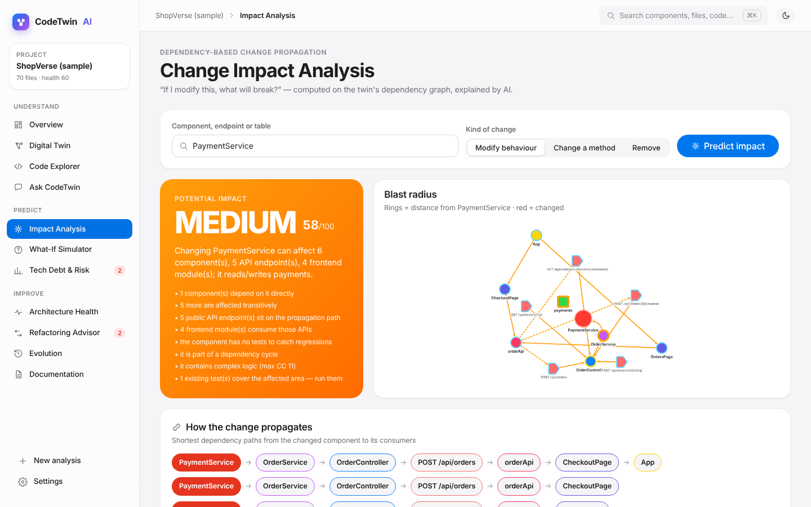
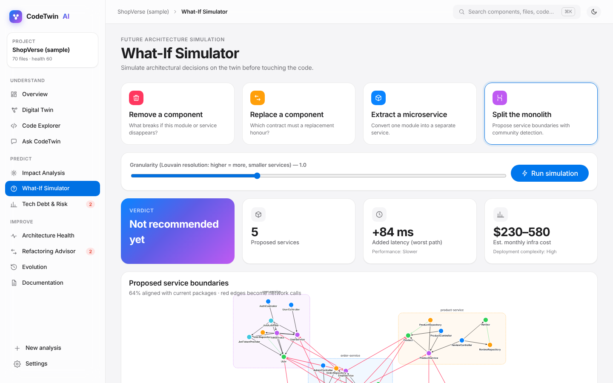
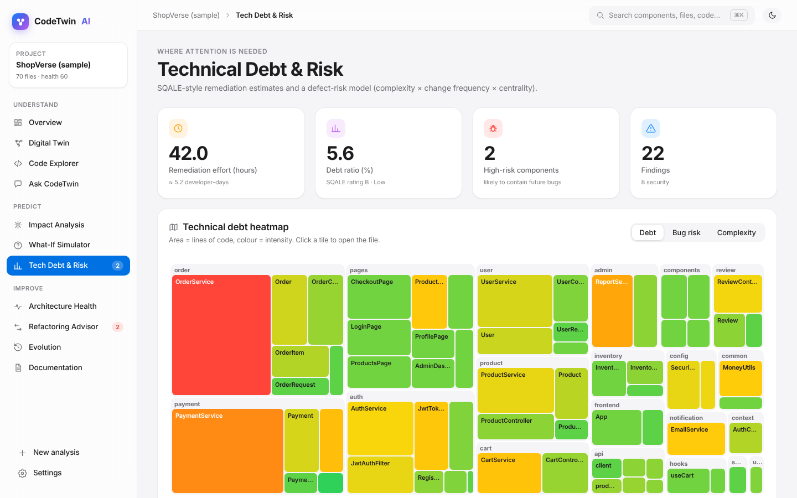
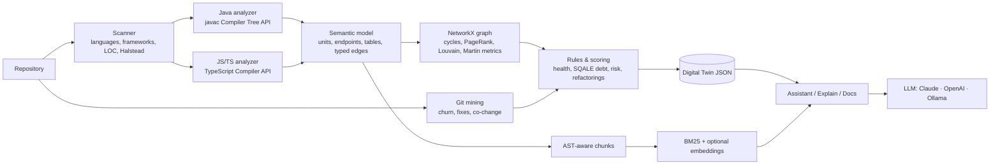

# CodeTwin AI — Intelligent Software Engineering Digital Twin

> **Understand, Predict, and Improve Software Before Problems Happen.**

CodeTwin builds a **digital twin of a software project**: a live, queryable model of its architecture, dependencies, quality and risks.
Developers can explore the system like a map, ask questions about it, **predict the impact of a change before making it**, simulate
architectural decisions (remove / replace / extract / split into microservices) and get evidence-based refactoring advice.

```
GitHub / ZIP / folder ─► AST parsing ─► dependency graph ─► metrics & rules ─► DIGITAL TWIN ─► RAG + LLM ─► answers & recommendations
```



| | |
|---|---|
|  |  |
|  |  |

---

## Features

| Area | What you get |
|---|---|
| **Repository import** | GitHub URL (incl. `/tree/<branch>`), ZIP upload, local folder, bundled demo project |
| **Automatic analysis** | Languages, frameworks, libraries, databases, files, classes, functions, modules, REST endpoints, DB tables |
| **Digital Twin graph** | Interactive Cytoscape graph — modules → components → endpoints → tables; colour by layer / risk / module; inspector with metrics, dependencies and dependents |
| **Code Explorer** | Syntax-highlighted source with complexity marks, “where does this code sit in the system?” side panel |
| **Ask CodeTwin (AI)** | Hybrid RAG: deterministic twin facts + AST-aware code retrieval + LLM; answers cite sources `[1] [2]` |
| **Change Impact Analysis ⭐** | Reverse reachability over the dependency graph (incl. interface polymorphism and frontend→backend HTTP links); affected components, endpoints, frontend screens, DB tables, tests to run, risk level and propagation chains |
| **What-If Simulator ⭐⭐⭐** | Remove a component · replace it (required contract) · extract a module as a microservice (remote operations, shared data, distributed transactions, latency/cost) · split the monolith (Louvain community detection) |
| **Architecture Health** | 8 measured dimensions — modularity, coupling, complexity, maintainability, documentation, testability, security, performance — plus Robert C. Martin's main-sequence chart |
| **Technical Debt & Risk** | SQALE-style remediation estimate, debt heatmap (treemap), defect-risk prediction (complexity × churn × centrality), hotspots, change coupling |
| **Refactoring Advisor** | Split god classes by responsibility, extract methods, break dependency cycles, introduce service layer, remove duplication, externalise state — each with the violated principle and a proposed design |
| **Evolution** | Git history mining (churn, authors, bug-fix commits) and architecture snapshots rebuilt at historic commits |
| **Documentation generator** | Overview, tech stack, architecture (Mermaid), modules, API reference, ER diagram, UML class diagram, **sequence diagrams generated from the call graph**, onboarding guide; export to Markdown |

Supported languages for deep analysis: **Java** (Spring MVC/Data JPA aware) and **JavaScript / TypeScript** (React, Express, NestJS, Axios/fetch, Prisma, Mongoose, Sequelize, TypeORM).

---

## Quick start

### Option A — Docker (one command)

```bash
docker compose up --build
# open http://localhost:8000  →  "Sample" → Build Digital Twin
```

Add an LLM key (optional) in `.env` (see `.env.example`) or later in **Settings**.

### Option B — Local development

Requirements: **Python 3.10+**, **Node.js 18+**, **JDK 17+** (for Java analysis), **git**.

```bash
# macOS / Linux
./scripts/setup.sh        # venv + pip, analyzer + frontend npm install
./scripts/dev.sh          # API on :8000, web app on :5173
```

```powershell
# Windows (PowerShell, from the codetwin folder)
npm run setup     # one-time
npm run dev       # API on :8000 + web app on :5173 (hot reload)
npm start         # or: one process serving everything on http://localhost:8000
```

`npm run dev` inside `frontend/` starts only the web page; use the commands above so the Python API starts too.

Open **http://localhost:5173**, choose **Sample → Build Digital Twin** and follow the demo below.

Manual steps if you prefer:

```bash
cd backend && python -m venv .venv && source .venv/bin/activate && pip install -r requirements.txt
(cd analyzers/js && npm install)
uvicorn app.main:app --reload --reload-dir app --port 8000   # API docs at http://localhost:8000/docs
cd ../frontend && npm install && npm run dev      # http://localhost:5173 (proxies /api to :8000)
```

Production build: `cd frontend && npm run build` — the API then serves the web app itself at http://localhost:8000.

---

## Deploying publicly (Render)

`render.yaml` deploys the Docker image as one web service (Render dashboard → **New → Blueprint** → this repository).
It turns on **public mode** (`CODETWIN_PUBLIC=1`), which is designed for an open demo link:

- local-folder import, project deletion and settings changes are disabled; AI is configured only through environment variables
- Git import accepts public `github.com`, `gitlab.com` and `bitbucket.org` URLs only, capped at `CODETWIN_MAX_REPO_MB` (250 MB)
- at most `CODETWIN_MAX_JOBS` (2) analyses run at once; ZIP uploads are capped by `CODETWIN_MAX_UPLOAD_MB`
- the ShopVerse sample is built automatically on first start
- set `CODETWIN_PASSWORD` to require a password for the whole site (any username)

On Render's free plan the service sleeps after ~15 minutes idle and storage is temporary, so imported projects
disappear on restart (the sample is rebuilt). For a live presentation, running locally with `npm start` is still the most reliable.

---

## AI providers

The whole deterministic engine (graph, metrics, impact, what-if, debt, docs) works **without any API key**. An LLM adds natural-language answers,
explanations and AI-written documentation.

| Provider | Configure |
|---|---|
| **Claude (default)** | `ANTHROPIC_API_KEY`, optional `CODETWIN_ANTHROPIC_MODEL` (default `claude-opus-5-5`) and `CODETWIN_ANTHROPIC_EFFORT` (`low`…`xhigh`, default `medium`) |
| OpenAI / compatible | `CODETWIN_LLM_PROVIDER=openai`, `OPENAI_API_KEY`, `OPENAI_BASE_URL` |
| Ollama (local, free) | `CODETWIN_LLM_PROVIDER=ollama`, `OLLAMA_URL`, `CODETWIN_OLLAMA_MODEL` |

Everything can also be set in the **Settings** page (keys are stored in `backend/data/settings.json`, never sent to the browser).
Model names change over time — set whichever current model your account has access to.

---

## Demo script (for the review / viva)

1. **Build** the ShopVerse sample → dashboard: *70 files · 67 components · 20 modules · 133 dependencies · 24 endpoints · 7 tables*.
2. **Digital Twin** → click `UserService` → see dependencies & dependents → **“What breaks if I change it?”** (ripple animation).
3. **Impact Analysis** → `PaymentService` → MEDIUM risk: OrderService → OrderController → `POST /api/orders` → orderApi → CheckoutPage; touches table `payments`; run `OrderControllerTest`.
4. **Architecture Health** → 60/100 and *why* (cycles, god class, missing tests, OWASP findings) → “Explain with AI”.
5. **Tech Debt & Risk** → heatmap; `PaymentService` is the top hotspot (13 commits, 4 bug-fixes, complexity 33).
6. **Refactoring Advisor** → “Split OrderService by responsibility” (payment, inventory, notification, …) and “Break the cycle PaymentService ↔ OrderService”.
7. **What-If** → *Split the monolith* → 5 proposed services, +84 ms, shared `inventory` table → “Not recommended yet” + migration path.
8. **Ask CodeTwin** → “Explain how authentication works in this project.” (cites `JwtAuthFilter`, `AuthService`, `SecurityConfig`).
9. **Documentation** → architecture diagram, sequence diagram of `POST /api/orders`, onboarding guide → Download `.md`.

---

## How it works



**Deterministic side** — understands structure, dependencies, metrics, relationships.
**AI side** — understands meaning, context, explanations, recommendations. Scores are never invented by the LLM; it only explains them.

### Key algorithms & metrics

| Metric | Definition |
|---|---|
| Cyclomatic complexity (CC) | 1 + decision points (`if`, loops, `case`, `catch`, `?:`, `&&`, `||`, `??`) per method, from the AST |
| WMC | Σ CC of a class's methods (Chidamber & Kemerer) |
| Fan-in / fan-out, instability | Afferent / efferent dependencies, I = Ce / (Ca + Ce) |
| Abstractness, distance | A = abstract types / types per module, D = \|A + I − 1\| (Robert C. Martin) |
| Modularity | Newman modularity Q of the package partition on the dependency graph |
| Maintainability Index | MI = max(0, (171 − 5.2 ln V − 0.23 CC − 16.2 ln SLOC) · 100/171) with Halstead volume V |
| Criticality | 0.5 · transitive dependents + 0.3 · PageRank + 0.2 · complexity (percentile ranks) |
| Defect risk | weighted percentile ranks of complexity, recent churn, bug-fix commits, transitive dependents, fan-out and size (+ untested, open findings) — the *hotspot* model |
| Technical debt | SQALE remediation minutes per finding; debt ratio = remediation / (SLOC × 30 min); rating A–E |
| Impact | reverse BFS over typed edges (`calls`, `injects`, `imports`, `http`, `handles`, …) + interface polymorphism; risk combines blast radius, endpoints, frontend reach, target risk, tests, cycles |
| Service proposal | Louvain community detection (NetworkX) on the backend graph; boundary analysis = remote operations, shared tables, cross-boundary `@Transactional` methods, cycles |
| Duplication | rolling hash over 6 normalised lines, merged into clone blocks |

---

## Project structure

```
codetwin/
├── backend/
│   ├── app/
│   │   ├── main.py              FastAPI routes (OpenAPI docs at /docs)
│   │   ├── projects.py          ingestion (zip/git/sample/local), background jobs, storage
│   │   ├── parsers/             bridges to the language analyzers
│   │   ├── analysis/            scanner, model, graph, checks, history, scoring, refactor, impact/what-if, builder
│   │   └── ai/                  llm providers, retrieval (RAG), assistant, docs generator
│   ├── analyzers/java/JavaAnalyzer.java   javac-based AST extractor (single-file program)
│   ├── analyzers/js/analyzer.js           TypeScript-compiler-based extractor
│   └── tests/test_twin.py                 end-to-end tests on the sample
├── frontend/                    React 19 + TypeScript + Vite · Cytoscape · GSAP · Mermaid
├── samples/shopverse/           Spring Boot + React demo project with git history
├── docker-compose.yml, Dockerfile, scripts/
```

API highlights: `POST /api/projects/{git|upload|sample|local}`, `GET /api/projects/{id}/twin`, `POST …/impact`, `POST …/whatif`,
`POST …/chat` (SSE), `POST …/explain` (SSE), `GET …/docs`, `GET/POST …/evolution`, `GET …/search`.

## Tests

```bash
cd backend && python -m pytest -q      # or: python tests/test_twin.py
```

## Scope (what we deliberately do **not** do)

No own LLM, no GitHub/IDE replacement, no perfect bug prediction, no automatic code modification, Java + JS/TS only.
**Future scope (Tier 3):** VS Code extension, GitHub PR impact comments, CI/CD gate, architecture-drift detection, more languages (tree-sitter), PostgreSQL + pgvector storage.

---
*7th-semester B.Tech CSE major project — UPES Dehradun.*
